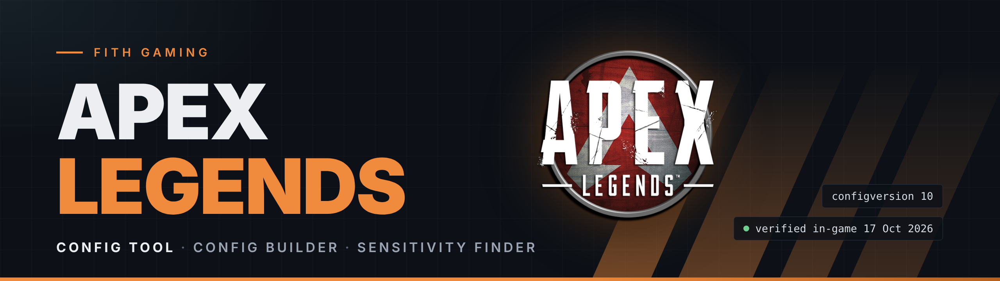
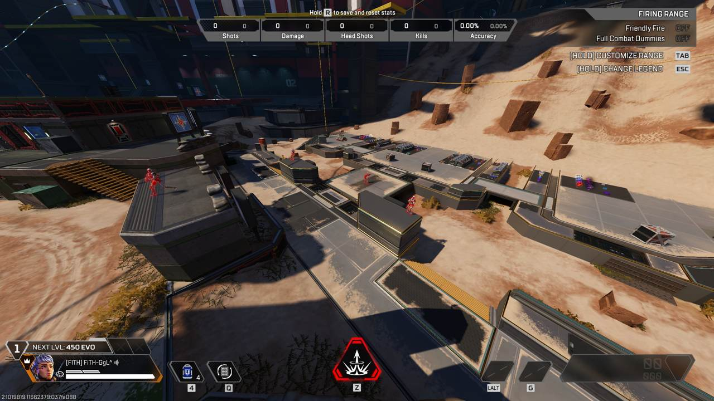
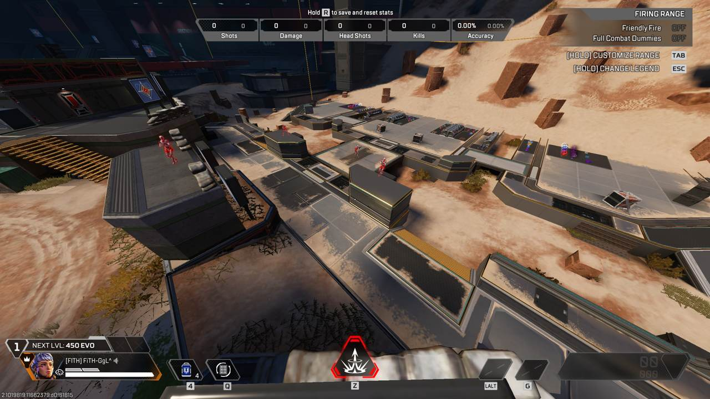
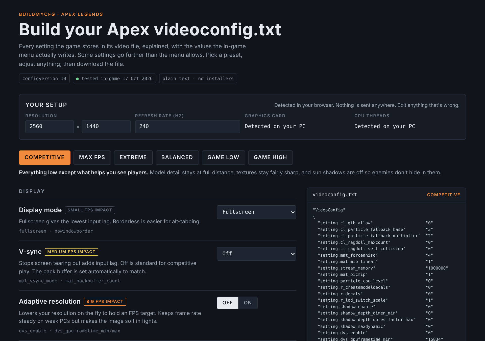
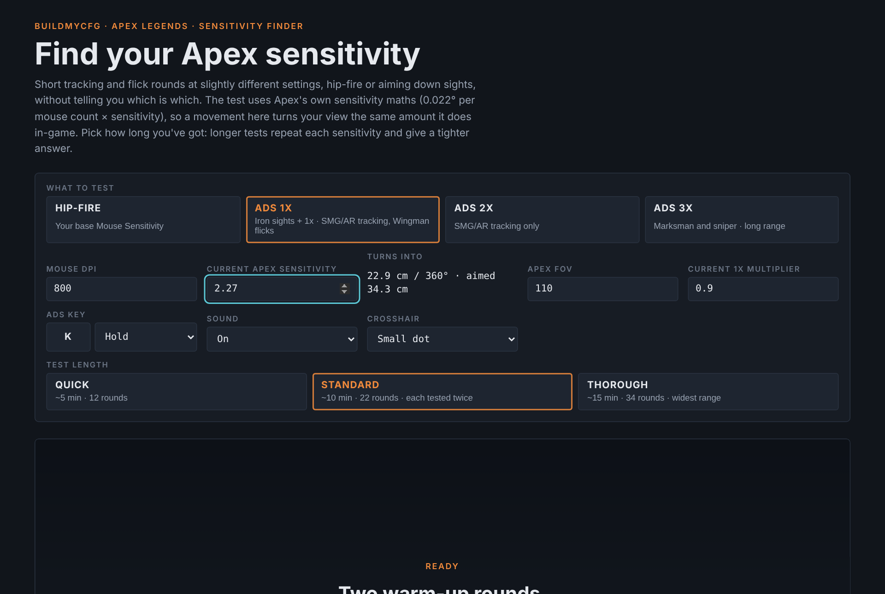

<p align="center">
  
</p>

<p align="center">
  
  
  
  
</p>

<p align="center">
  <a href="#%EF%B8%8F-desktop-tool"><b>Desktop Tool</b></a> ·
  <a href="https://fithgaming.co.uk/apex/"><b>Config Builder</b></a> ·
  <a href="https://fithgaming.co.uk/apex-sensitivity/"><b>Sensitivity Finder</b></a> ·
  <a href="#-fith-settings"><b>My Settings</b></a> ·
  <a href="#-install"><b>Install</b></a> ·
  <a href="docs/settings-reference.md"><b>Every Setting Explained</b></a>
</p>

<p align="center">
  <a href="https://fithgaming.co.uk"></a>
  <a href="https://discord.gg/Br7z7zBvFb"></a>
  <a href="https://www.youtube.com/FiTHGAMINGOFFICIAL"></a>
  <a href="https://www.facebook.com/gaming/FiTHGAMINGOFFICIAL"></a>
</p>

---

Competitive Apex Legends settings that have been **tested in the game**, not copied from old guides. Every config here is a plain text file you can read line by line, and every claim below was checked in the Firing Range on the current version of the game.

## 🎯 Settings

<table>
<tr>
<td valign="top" width="50%">

#### Mouse

| | |
|---|---|
| **DPI** | 800 |
| **Sensitivity** | 2.27 |
| **eDPI** | 1816 |
| **cm / 360°** | 22.9 cm *(ruler-tested)* |
| **Per Optic ADS** | On |
| **1x / Iron Sights** | 0.90 |
| **2x / 3x / 4x** | 1.00 |
| **6x / 8x / 10x** | 1.00 |

</td>
<td valign="top" width="50%">

#### Display

| | |
|---|---|
| **Resolution** | 2560 × 1440 |
| **Display mode** | Fullscreen |
| **Field of view** | 110 |
| **V-sync** | Off |
| **Adaptive resolution** | Off |
| **Anti-aliasing** | Off |
| **Launch options** | `+exec autoexec` |

</td>
</tr>
<tr>
<td valign="top">

#### Textures and models

| | |
|---|---|
| **Texture streaming budget** | 3000000 (max) |
| **Texture quality** | `mat_picmip 1` |
| **Texture filtering** | Anisotropic 4x |
| **Model detail** | 0.75 |
| **Map detail** | Low |
| **Effects detail** | Low |
| **Ragdolls** | 0 |

</td>
<td valign="top">

#### Lighting

| | |
|---|---|
| **Sun shadows** | **Off** *(file only)* |
| **Spot shadows** | Off |
| **Volumetric lighting** | Off |
| **Ambient occlusion** | Off |
| **Ragdoll self-collision** | Off *(file only)* |
| **Impact marks** | Off |

</td>
</tr>
</table>

The idea: **everything low except what helps you see players.** Textures and model detail stay high enough that distant enemies don't turn into blobs, and sun shadows are off so nobody hides in them.

👉 Download it: [`configs/videoconfig-fith-competitive.txt`](configs/videoconfig-fith-competitive.txt)

## ☀️ The setting the menu can't give you

Even at the menu's lowest preset, Apex keeps **sun shadows on** (`csm_enabled 1`). Setting it to `0` in `videoconfig.txt` turns them off. You gain frames, and the dark shapes enemies stand in disappear.

<table>
<tr>
<td width="50%"></td>
<td width="50%"></td>
</tr>
<tr>
<td align="center"><b>Sun shadows ON</b> · menu Low and High</td>
<td align="center"><b>Sun shadows OFF</b> · file only</td>
</tr>
</table>

## 🖥️ Desktop Tool

**g1gGLe'z Apex Legends Performance Tool** does the whole install for you. It finds your `videoconfig.txt`, detects your rig, shows every change before anything is written, and backs up your file first.

- **Same presets as the Config Builder.** Competitive is g1gGLe's own settings. **Auto** picks a preset from your video memory and CPU.
- **See every change first.** A live list shows each setting, what it is now and what it will become. Hover any row for what it does and **why**.
- **Keeps what's yours.** Your brightness and master volume stay as they are unless you move the sliders, and only the values that need changing are touched.
- **FPS cap into Steam for you.** Writes `+fps_max` to Apex's Steam launch options and keeps your other options, such as `+exec autoexec`. It closes Steam cleanly first if it needs to.
- **One-click undo.** Every apply makes a timestamped backup, and it reads the files back after writing. If anything doesn't check out, your files are put back automatically.

**Run it**

1. **[Download the repo](https://github.com/FiTH-g1gGLe/ApexLegends/archive/refs/heads/main.zip)** and unzip it.
2. Double-click **`Run Apex Config Tool.cmd`**.
3. Check **YOUR RIG**, pick a **LOADOUT**, review **CHANGES TO APPLY**, and hit **APPLY**.

> [!NOTE]
> Close Apex first. Launch the game once beforehand if you've never played on this PC, so `videoconfig.txt` exists.

<details>
<summary><b>Command line</b></summary>

```powershell
# Show what would change without writing anything
powershell -ExecutionPolicy Bypass -File .\Apex-Config-Tool.ps1 -Silent -DryRun

# Apply a preset with no window (Auto, Competitive, MaxFPS, Extreme, Balanced, GameLow, GameHigh)
powershell -ExecutionPolicy Bypass -File .\Apex-Config-Tool.ps1 -Silent -Preset Competitive
```

Backups are kept in `%LOCALAPPDATA%\ApexConfigTool\backups`.

</details>

## 🧰 Tools

<table>
<tr>
<td width="50%" valign="top">

### Config Builder

Build your own `videoconfig.txt`. Every setting has a plain-English explanation, its FPS impact, and the values the menu really writes. It detects your resolution, refresh rate and GPU in the browser.

**Presets:** Competitive · Max FPS · Extreme · Balanced · Game Low · Game High

[**Open it online →**](https://fithgaming.co.uk/apex/)

</td>
<td width="50%" valign="top">

### Sensitivity Finder

A blind aim test that finds your sensitivity from short tracking and flick rounds. It tests each sight the way it's used:

- **Hip-fire**: tracking + flicks
- **ADS 1x**: SMG/AR tracking + Wingman flicks
- **ADS 2x**: SMG/AR tracking only
- **ADS 3x**: marksman and sniper range

[**Open it online →**](https://fithgaming.co.uk/apex-sensitivity/)

</td>
</tr>
<tr>
<td></td>
<td></td>
</tr>
</table>

## 📁 Configs

| File | What it is | Best for |
|---|---|---|
| [`videoconfig-fith-competitive.txt`](configs/videoconfig-fith-competitive.txt) | Low everything, sharp players, no sun shadows | Ranked, visibility |
| [`videoconfig-game-low.txt`](configs/videoconfig-game-low.txt) | Exactly what the menu writes at Low | Reference |
| [`videoconfig-game-high.txt`](configs/videoconfig-game-high.txt) | The menu's High, with V-sync and adaptive resolution off | Strong PCs, casual play |

All three are set to 2560 × 1440. Change the four resolution lines to yours, or let the [Config Builder](https://fithgaming.co.uk/apex/) detect it.

## 🔧 Install

The easy way is the [Desktop Tool](#%EF%B8%8F-desktop-tool). To install a file by hand:

1. Close Apex Legends completely.
2. Press <kbd>Win</kbd> + <kbd>R</kbd>, paste `%USERPROFILE%\Saved Games\Respawn\Apex\local` and press <kbd>Enter</kbd>.
3. Back up your current `videoconfig.txt`.
4. Drop in the new file, named exactly `videoconfig.txt`.
5. Launch and play. **Don't open the video settings menu**; saving anything there rewrites the file with menu values.

> [!TIP]
> The file survives restarts without being read-only. To undo, put your backup back, or delete the file and the game creates a fresh one.

## ✅ Verified in-game

| Test | Result |
|---|---|
| Hand-edited `videoconfig.txt` applies and survives a restart | ✅ Works |
| `csm_enabled 0` (sun shadows off, not possible in the menu) | ✅ Works |
| Autoexec runs via `+exec autoexec` (test keybind) | ✅ Works |
| `cl_fovScale` in autoexec (FOV above 110) | ❌ Blocked |
| Hip-fire cm/360 formula vs a ruler | ✅ Matches (22.9 cm) |
| Sight zoom: 1x / 2x / 3x vs hip-fire at FOV 110 | 📏 1.19× / 2.22× / 3.45× |

## 📚 Docs

| Page | What's in it |
|---|---|
| [Settings reference](docs/settings-reference.md) | All 42 `videoconfig.txt` settings with real menu Low/High values |
| [ADS sensitivity](docs/ads-sensitivity.md) | How Apex slows your mouse per sight, with measurements |
| [Autoexec](docs/autoexec.md) | What still works, what's blocked, and what to test next |
| [File format history](docs/file-format-history.md) | Why old configs from 2020–2024 stop working |

<p align="center">
  <sub>Made by <b>FiTH-g1gGLe</b> · <a href="https://fithgaming.co.uk">fithgaming.co.uk</a> · Not affiliated with Respawn Entertainment or Electronic Arts.</sub>
</p>
